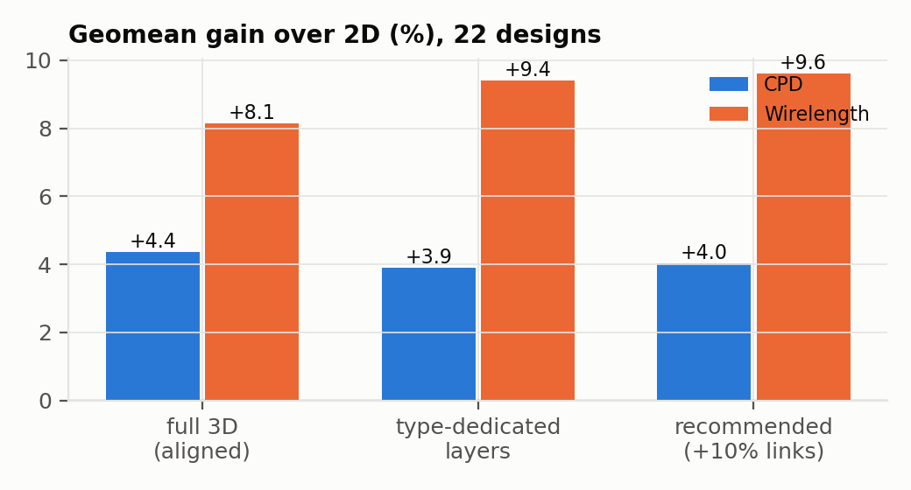
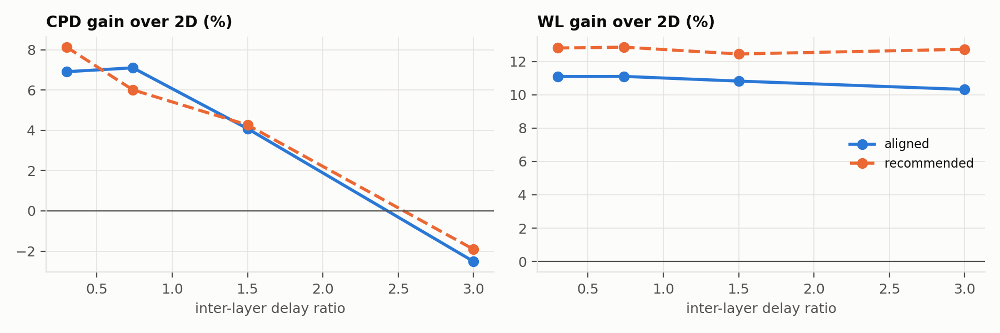

<!-- generated by campaign/analyze.py from campaign_work/study/results (167 results) -->

## RQ1: 3D vs 2D at equal resources

Improvement of the 3D device over the 2D device with the same tile and block counts (positive = 3D better). Mean ± 95% CI over paired seeds.

| design | 2D | 3D | use CLB/DSP/BRAM (2D) | CPD 2D (ns) | CPD 3D (ns) | CPD gain % | WL gain % | seeds |
|---|---|---|---|---|---|---|---|---|
| spmv | 119×122 | 2×87×86 | 7/4/77% | 9.54 | 7.26 | +23.8 ± 7.1 | +15.9 ± 0.9 | 5 |
| clstm_like.small | 148×182 | 2×124×110 | 80/45/45% | 11.63 | 9.99 | +13.9 ± 7.5 | +10.1 ± 2.4 | 5 |
| bwave_like.fixed.small | 142×146 | 2×95×110 | 8/22/79% | 12.42 | 10.96 | +11.7 ± 7.1 | +16.1 ± 1.5 | 5 |
| tpu_like.small.os | 78×74 | 2×62×50 | 71/80/53% | 7.55 | 7.00 | +7.3 ± 6.5 | +7.9 ± 3.6 | 5 |
| eltwise_layer | 87×86 | 2×62×62 | 25/5/75% | 6.90 | 6.40 | +7.1 ± 7.1 | +15.3 ± 1.9 | 5 |
| stereovision1 | 62×50 | 2×46×38 | 67/79/0% | 6.26 | 5.93 | +5.1 ± 4.4 | +9.3 ± 3.3 | 5 |
| dla_like.small | 131×134 | 2×91×98 | 80/21/27% | 11.58 | 11.00 | +5.0 ± 2.5 | +5.8 ± 1.0 | 5 |
| reduction_layer | 55×62 | 2×46×38 | 38/0/74% | 8.31 | 7.89 | +5.0 ± 5.1 | +2.2 ± 2.0 | 5 |
| tpu_like.small.ws | 71×86 | 2×62×50 | 65/77/67% | 11.79 | 11.20 | +4.9 ± 6.0 | +11.0 ± 2.8 | 5 |
| mkDelayWorker32B | 62×50 | 2×46×38 | 32/0/78% | 9.11 | 8.68 | +4.7 ± 5.1 | +9.0 ± 2.6 | 5 |
| robot_rl | 62×50 | 2×42×38 | 74/19/75% | 11.79 | 11.51 | +2.4 ± 2.9 | +4.4 ± 3.0 | 5 |
| stereovision0 | 50×50 | 2×34×38 | 79/0/0% | 4.29 | 4.24 | +1.1 ± 6.2 | +7.1 ± 1.8 | 5 |
| mcml | 140×134 | 2×97×98 | 79/14/72% | 81.71 | 80.94 | +0.9 ± 3.3 | +7.7 ± 2.6 | 5 |
| bgm | 76×74 | 2×58×50 | 79/7/8% | 20.92 | 20.81 | +0.4 ± 5.1 | +2.1 ± 2.7 | 5 |
| softmax | 51×62 | 2×43×38 | 80/9/3% | 7.65 | 7.61 | +0.4 ± 7.8 | +4.7 ± 2.8 | 5 |
| LU8PEEng | 75×62 | 2×49×50 | 80/6/44% | 90.29 | 89.99 | +0.3 ± 3.5 | +6.6 ± 1.9 | 5 |
| conv_layer | 87×74 | 2×55×62 | 49/21/80% | 9.12 | 9.09 | +0.2 ± 3.5 | +8.8 ± 0.8 | 5 |
| stereovision2 | 88×110 | 2×78×62 | 45/79/1% | 17.56 | 17.59 | -0.2 ± 4.0 | +5.7 ± 1.8 | 5 |
| attention_layer | 78×98 | 2×63×62 | 41/28/79% | 10.68 | 10.75 | -0.8 ± 5.9 | +9.4 ± 2.0 | 5 |
| blob_merge | 30×38 | 2×23×26 | 76/0/0% | 11.58 | 11.69 | -1.0 ± 2.9 | +1.7 ± 2.1 | 5 |
| arm_core | 55×50 | 2×39×38 | 57/0/71% | 22.10 | 22.31 | -1.0 ± 5.3 | +6.7 ± 1.7 | 5 |
| LU32PEEng | 116×134 | 2×92×86 | 79/7/46% | 91.42 | 92.41 | -1.1 ± 1.3 | +9.4 ± 2.3 | 5 |

**Geomean over 22 designs: CPD +4.4%, WL +8.1%.** 3D wins CPD on 17/22 and WL on 22/22 designs.

| property | Spearman vs CPD gain | Spearman vs WL gain |
|---|---|---|
| 2D device side (sqrt tiles) | +0.32 | +0.54 |
| hard-block share of used tiles | +0.42 | +0.66 |
| CLB utilization | -0.27 | -0.42 |
| max(DSP,BRAM) utilization | +0.26 | +0.48 |

## RQ2: hard-block placement across layers

Each layout vs the aligned reference (evenly spread hard-block columns, identical layers) on the same 3D device, same block totals. Positive = better than aligned. Mean ± 95% CI over paired seeds.

**CPD gain % vs aligned**

| layout | LU32PEEng | LU8PEEng | arm_core | attention_layer | bgm | blob_merge | bwave_like.fixed.small | clstm_like.small | conv_layer | dla_like.small | eltwise_layer | mcml | mkDelayWorker32B | reduction_layer | robot_rl | softmax | spmv | stereovision0 | stereovision1 | stereovision2 | tpu_like.small.os | tpu_like.small.ws | mean |
|---|---|---|---|---|---|---|---|---|---|---|---|---|---|---|---|---|---|---|---|---|---|---|---|
| staggered | – | -2.0 ± 2.6 | -2.9 ± 5.2 | -0.3 ± 5.1 | – | – | – | – | -0.7 ± 3.4 | – | +1.4 ± 7.7 | – | -2.0 ± 3.4 | +1.4 ± 4.7 | -2.8 ± 4.4 | – | – | – | -0.3 ± 6.0 | -0.5 ± 6.3 | -0.4 ± 6.5 | +0.8 ± 3.6 | -0.7 |
| hb_one_layer | – | +1.9 ± 2.0 | +4.5 ± 3.6 | -0.8 ± 4.3 | – | – | – | – | -3.4 ± 3.4 | – | -6.7 ± 4.2 | – | -1.7 ± 4.8 | -0.8 ± 5.7 | -2.7 ± 3.9 | – | – | – | -1.2 ± 2.8 | -2.0 ± 2.7 | -0.3 ± 7.3 | -1.1 ± 5.6 | -1.2 |
| split_types | -0.2 ± 4.5 | -2.7 ± 1.5 | +0.3 ± 6.3 | -2.4 ± 3.1 | -0.8 ± 5.9 | -2.7 ± 10.1 | -0.0 ± 3.1 | +0.2 ± 7.2 | -2.3 ± 6.1 | -1.3 ± 1.9 | +1.5 ± 8.9 | -0.7 ± 4.9 | -3.9 ± 4.9 | -2.6 ± 4.6 | -0.2 ± 1.4 | +0.5 ± 3.4 | -0.6 ± 6.8 | +1.1 ± 9.2 | +0.8 ± 4.4 | +1.8 ± 1.9 | +2.1 ± 5.1 | -0.8 ± 2.5 | -0.6 |
| center | – | +0.4 ± 2.9 | -8.2 ± 11.7 | -6.5 ± 6.8 | – | – | – | – | -4.2 ± 4.7 | – | -3.9 ± 7.2 | – | -8.0 ± 3.6 | -4.7 ± 3.4 | -5.0 ± 4.8 | – | – | – | -2.5 ± 2.9 | -10.2 ± 9.4 | -15.9 ± 5.5 | -4.7 ± 7.8 | -6.1 |
| edges | – | – | +2.1 ± 4.3 | -2.9 ± 6.2 | – | – | – | – | -3.7 ± 9.4 | – | – | – | – | – | -6.5 ± 3.2 | – | – | – | -8.3 ± 3.2 | – | -5.8 ± 3.1 | – | -4.2 |
| center_edges | – | – | +1.1 ± 1.9 | -3.5 ± 5.0 | – | – | – | – | -1.6 ± 4.1 | – | – | – | – | – | -2.5 ± 3.1 | – | – | – | -6.5 ± 4.6 | – | -1.3 ± 4.4 | – | -2.4 |

**WL gain % vs aligned**

| layout | LU32PEEng | LU8PEEng | arm_core | attention_layer | bgm | blob_merge | bwave_like.fixed.small | clstm_like.small | conv_layer | dla_like.small | eltwise_layer | mcml | mkDelayWorker32B | reduction_layer | robot_rl | softmax | spmv | stereovision0 | stereovision1 | stereovision2 | tpu_like.small.os | tpu_like.small.ws | mean |
|---|---|---|---|---|---|---|---|---|---|---|---|---|---|---|---|---|---|---|---|---|---|---|---|
| staggered | – | -0.2 ± 1.4 | -1.3 ± 1.7 | -0.4 ± 1.6 | – | – | – | – | +0.1 ± 2.2 | – | +0.4 ± 1.2 | – | +0.1 ± 1.7 | +1.1 ± 1.7 | -0.7 ± 1.2 | – | – | – | -0.0 ± 4.3 | +0.5 ± 2.1 | +1.1 ± 4.1 | +0.5 ± 2.0 | +0.1 |
| hb_one_layer | – | +0.6 ± 2.2 | +1.4 ± 0.6 | +1.6 ± 1.0 | – | – | – | – | -0.9 ± 1.8 | – | +2.5 ± 0.7 | – | +2.6 ± 2.0 | +0.8 ± 2.6 | -3.4 ± 1.8 | – | – | – | -0.3 ± 2.6 | -1.1 ± 2.3 | -2.3 ± 4.2 | +1.6 ± 2.0 | +0.3 |
| split_types | +1.5 ± 2.6 | -0.3 ± 1.9 | +0.7 ± 0.7 | -0.6 ± 2.4 | -0.4 ± 1.5 | -0.6 ± 1.1 | +6.1 ± 1.1 | +0.7 ± 3.0 | +2.0 ± 1.3 | +1.2 ± 0.9 | +1.3 ± 2.6 | +3.4 ± 3.2 | +6.6 ± 1.1 | +3.6 ± 3.0 | -2.5 ± 2.2 | -1.4 ± 4.2 | +2.9 ± 4.1 | -2.3 ± 3.8 | +1.0 ± 3.0 | +4.3 ± 2.0 | -0.2 ± 2.1 | +1.9 ± 2.3 | +1.3 |
| center | – | +0.1 ± 1.1 | +0.3 ± 4.5 | -8.7 ± 1.4 | – | – | – | – | -6.3 ± 1.8 | – | +4.7 ± 1.7 | – | +1.0 ± 2.1 | -0.8 ± 3.5 | -4.5 ± 3.1 | – | – | – | -7.4 ± 2.2 | -15.1 ± 1.5 | -18.1 ± 6.2 | -8.7 ± 2.1 | -5.3 |
| edges | – | – | +4.9 ± 2.7 | -17.8 ± 3.4 | – | – | – | – | -17.3 ± 2.8 | – | – | – | – | – | -3.7 ± 1.8 | – | – | – | -10.0 ± 6.3 | – | -27.2 ± 6.0 | – | -11.9 |
| center_edges | – | – | +4.4 ± 1.7 | -7.2 ± 2.0 | – | – | – | – | -5.3 ± 1.4 | – | – | – | – | – | -3.2 ± 0.8 | – | – | – | -2.2 ± 3.0 | – | -10.0 ± 4.8 | – | -3.9 |

## RQ3: vertical connectivity vs cost

3D reference layout with a fraction p of switch blocks made 3D (all channels crossing), and with all switch blocks 3D but only a fraction v of channels crossing. Change vs full connectivity (p = 1, v = 1); positive = better. The 2D device (no vertical links) is shown for scale.

| design | config | relative links | CPD vs full % | WL vs full % |
|---|---|---|---|---|
| attention_layer | p=0.1, v=1 | 0.10 | -5.6 ± 4.9 | -5.8 ± 1.9 |
| attention_layer | p=0.2, v=0.5 | 0.10 | -2.1 ± 3.8 | -1.8 ± 2.5 |
| attention_layer | p=0.25, v=1 | 0.25 | -2.2 ± 6.7 | -1.8 ± 1.0 |
| attention_layer | p=0.5, v=0.2 | 0.10 | -0.4 ± 3.6 | +0.0 ± 1.2 |
| attention_layer | p=0.5, v=0.5 | 0.25 | +1.1 ± 4.7 | +0.1 ± 1.0 |
| attention_layer | p=0.5, v=1 | 0.50 | -2.6 ± 8.6 | -0.8 ± 2.0 |
| attention_layer | p=0.75, v=1 | 0.75 | -1.0 ± 3.6 | -1.0 ± 1.4 |
| attention_layer | p=1, v=0.05 | 0.05 | +1.1 ± 4.6 | -2.7 ± 1.5 |
| attention_layer | p=1, v=0.1 | 0.10 | -1.2 ± 6.8 | +1.2 ± 1.9 |
| attention_layer | p=1, v=0.25 | 0.25 | -1.3 ± 4.7 | -0.7 ± 2.4 |
| attention_layer | p=1, v=0.5 | 0.50 | +1.5 ± 5.8 | +0.2 ± 1.7 |
| attention_layer | 2D device | 0 | +0.6 ± 6.2 | -10.3 ± 2.4 |
| conv_layer | p=0.1, v=1 | 0.10 | -4.4 ± 7.9 | -5.1 ± 2.1 |
| conv_layer | p=0.2, v=0.5 | 0.10 | -0.7 ± 3.1 | -2.3 ± 1.9 |
| conv_layer | p=0.25, v=1 | 0.25 | -1.0 ± 4.9 | -1.9 ± 1.6 |
| conv_layer | p=0.5, v=0.2 | 0.10 | -0.3 ± 3.8 | -0.1 ± 1.4 |
| conv_layer | p=0.5, v=1 | 0.50 | -4.0 ± 7.6 | -0.5 ± 2.4 |
| conv_layer | p=1, v=0.1 | 0.10 | -2.7 ± 3.9 | -0.9 ± 1.1 |
| conv_layer | p=1, v=0.25 | 0.25 | -1.4 ± 3.4 | +0.3 ± 1.5 |
| conv_layer | p=1, v=0.5 | 0.50 | -1.8 ± 4.9 | +0.3 ± 1.3 |
| conv_layer | 2D device | 0 | -0.3 ± 3.5 | -9.7 ± 0.9 |
| eltwise_layer | p=0.1, v=1 | 0.10 | -6.9 ± 6.9 | -8.0 ± 2.8 |
| eltwise_layer | p=0.2, v=0.5 | 0.10 | -11.9 ± 11.5 | -3.9 ± 3.4 |
| eltwise_layer | p=0.25, v=1 | 0.25 | -4.0 ± 4.9 | -2.0 ± 1.7 |
| eltwise_layer | p=0.5, v=0.2 | 0.10 | -8.5 ± 8.4 | -1.7 ± 2.7 |
| eltwise_layer | p=0.5, v=1 | 0.50 | -1.6 ± 11.4 | -0.4 ± 2.8 |
| eltwise_layer | p=1, v=0.1 | 0.10 | -8.6 ± 8.8 | -1.3 ± 2.6 |
| eltwise_layer | p=1, v=0.25 | 0.25 | -3.3 ± 5.5 | -0.1 ± 2.1 |
| eltwise_layer | p=1, v=0.5 | 0.50 | -3.2 ± 7.3 | +0.1 ± 2.1 |
| eltwise_layer | 2D device | 0 | -8.0 ± 8.0 | -18.1 ± 2.7 |
| robot_rl | p=0.1, v=1 | 0.10 | -5.2 ± 3.0 | -2.3 ± 1.8 |
| robot_rl | p=0.2, v=0.5 | 0.10 | -1.7 ± 3.3 | -0.9 ± 1.1 |
| robot_rl | p=0.25, v=1 | 0.25 | -2.1 ± 8.2 | -0.3 ± 2.5 |
| robot_rl | p=0.5, v=0.2 | 0.10 | -0.4 ± 2.8 | -1.4 ± 2.0 |
| robot_rl | p=0.5, v=0.5 | 0.25 | +0.2 ± 3.6 | -0.4 ± 1.4 |
| robot_rl | p=0.5, v=1 | 0.50 | -0.9 ± 5.4 | -0.0 ± 2.2 |
| robot_rl | p=0.75, v=1 | 0.75 | -2.0 ± 2.6 | -0.6 ± 1.9 |
| robot_rl | p=1, v=0.05 | 0.05 | +0.2 ± 3.6 | -1.6 ± 0.3 |
| robot_rl | p=1, v=0.1 | 0.10 | +0.9 ± 2.6 | -0.3 ± 2.0 |
| robot_rl | p=1, v=0.25 | 0.25 | -0.4 ± 3.3 | -0.6 ± 2.2 |
| robot_rl | p=1, v=0.5 | 0.50 | -0.8 ± 3.4 | -0.4 ± 1.5 |
| robot_rl | 2D device | 0 | -2.5 ± 3.0 | -4.7 ± 3.4 |
| stereovision1 | p=0.1, v=1 | 0.10 | -6.1 ± 2.7 | -7.8 ± 3.6 |
| stereovision1 | p=0.2, v=0.5 | 0.10 | -2.2 ± 3.8 | -4.1 ± 4.4 |
| stereovision1 | p=0.25, v=1 | 0.25 | -1.1 ± 2.7 | -2.7 ± 3.1 |
| stereovision1 | p=0.5, v=0.2 | 0.10 | +0.6 ± 3.5 | -2.5 ± 2.8 |
| stereovision1 | p=0.5, v=0.5 | 0.25 | -2.2 ± 4.7 | -3.1 ± 4.4 |
| stereovision1 | p=0.5, v=1 | 0.50 | -2.5 ± 1.5 | -0.4 ± 1.4 |
| stereovision1 | p=0.75, v=1 | 0.75 | -0.7 ± 4.1 | -1.8 ± 3.1 |
| stereovision1 | p=1, v=0.05 | 0.05 | -3.3 ± 4.6 | -3.8 ± 3.5 |
| stereovision1 | p=1, v=0.1 | 0.10 | +1.4 ± 1.6 | -0.3 ± 2.2 |
| stereovision1 | p=1, v=0.25 | 0.25 | +0.5 ± 2.4 | -0.7 ± 2.5 |
| stereovision1 | p=1, v=0.5 | 0.50 | +1.5 ± 4.2 | -0.3 ± 2.8 |
| stereovision1 | 2D device | 0 | -5.5 ± 4.8 | -10.3 ± 3.9 |
| tpu_like.small.os | p=0.1, v=1 | 0.10 | -6.1 ± 2.9 | -5.1 ± 4.1 |
| tpu_like.small.os | p=0.2, v=0.5 | 0.10 | -5.7 ± 7.2 | -3.5 ± 3.8 |
| tpu_like.small.os | p=0.25, v=1 | 0.25 | -6.0 ± 4.7 | -2.2 ± 2.6 |
| tpu_like.small.os | p=0.5, v=0.2 | 0.10 | -3.3 ± 6.8 | -2.2 ± 4.8 |
| tpu_like.small.os | p=0.5, v=0.5 | 0.25 | -2.0 ± 5.7 | -1.6 ± 3.9 |
| tpu_like.small.os | p=0.5, v=1 | 0.50 | -1.6 ± 6.1 | -1.1 ± 3.1 |
| tpu_like.small.os | p=0.75, v=1 | 0.75 | -3.7 ± 4.6 | -0.7 ± 2.7 |
| tpu_like.small.os | p=1, v=0.05 | 0.05 | -0.9 ± 6.7 | -2.8 ± 4.4 |
| tpu_like.small.os | p=1, v=0.1 | 0.10 | -2.3 ± 6.4 | -1.4 ± 4.6 |
| tpu_like.small.os | p=1, v=0.25 | 0.25 | -1.6 ± 5.9 | +0.8 ± 4.3 |
| tpu_like.small.os | p=1, v=0.5 | 0.50 | -0.8 ± 3.7 | +0.4 ± 3.5 |
| tpu_like.small.os | 2D device | 0 | -8.1 ± 7.8 | -8.6 ± 4.3 |

**Mean over designs, by strategy** (same link budget p·v):

| links | fewer 3D switch blocks: CPD / WL % | fewer crossing channels: CPD / WL % |
|---|---|---|
| 0.05 | – | -0.7 / -2.7 (n=4) |
| 0.1 | -5.7 / -5.7 (n=6) | -2.1 / -0.5 (n=6) |
| 0.25 | -2.7 / -1.8 (n=6) | -1.2 / -0.2 (n=6) |
| 0.5 | -2.2 / -0.5 (n=6) | -0.6 / +0.0 (n=6) |
| 0.75 | -1.9 / -1.1 (n=4) | – |

## RQ2 confirmation (10 paired seeds)

| design | layout | CPD gain % vs aligned | WL gain % vs aligned | seeds |
|---|---|---|---|---|
| conv_layer | hb_one_layer | -1.5 ± 2.7 | -1.1 ± 1.0 | 10 |
| conv_layer | hb_top | -2.0 ± 2.7 | -1.0 ± 0.9 | 10 |
| conv_layer | split_rev | -1.8 ± 3.2 | +2.1 ± 0.7 | 10 |
| conv_layer | split_types | -0.8 ± 3.1 | +1.4 ± 1.0 | 10 |
| eltwise_layer | hb_one_layer | -5.9 ± 2.5 | +2.4 ± 1.1 | 10 |
| eltwise_layer | hb_top | -3.0 ± 4.1 | +2.7 ± 1.4 | 10 |
| eltwise_layer | split_rev | -2.1 ± 4.3 | +2.2 ± 1.4 | 10 |
| eltwise_layer | split_types | -0.5 ± 4.3 | +1.9 ± 1.2 | 10 |
| mkDelayWorker32B | hb_one_layer | -2.3 ± 3.1 | +2.3 ± 1.0 | 10 |
| mkDelayWorker32B | hb_top | -3.0 ± 3.4 | +1.4 ± 1.3 | 10 |
| mkDelayWorker32B | split_rev | +1.2 ± 3.2 | +4.8 ± 1.2 | 10 |
| mkDelayWorker32B | split_types | -2.1 ± 2.5 | +5.8 ± 0.8 | 10 |
| reduction_layer | hb_one_layer | -1.0 ± 3.7 | -0.0 ± 1.3 | 10 |
| reduction_layer | hb_top | -1.3 ± 3.8 | -2.1 ± 1.2 | 10 |
| reduction_layer | split_rev | +0.1 ± 3.6 | +3.8 ± 1.5 | 10 |
| reduction_layer | split_types | -0.5 ± 2.7 | +2.6 ± 1.5 | 10 |
| stereovision2 | hb_one_layer | -2.6 ± 1.7 | -1.1 ± 1.3 | 10 |
| stereovision2 | hb_top | -2.9 ± 2.0 | -2.0 ± 1.2 | 10 |
| stereovision2 | split_rev | -1.4 ± 2.2 | +3.0 ± 1.8 | 10 |
| stereovision2 | split_types | +0.8 ± 2.5 | +4.4 ± 1.2 | 10 |
| tpu_like.small.ws | hb_one_layer | -1.0 ± 3.5 | +2.5 ± 1.2 | 10 |
| tpu_like.small.ws | hb_top | -1.1 ± 3.8 | +4.4 ± 1.5 | 10 |
| tpu_like.small.ws | split_rev | -2.0 ± 2.8 | +3.8 ± 1.1 | 10 |
| tpu_like.small.ws | split_types | -1.6 ± 2.6 | +2.9 ± 1.3 | 10 |

## RQ3: where to put the 3D switch blocks (fixed budget)

Change vs full connectivity. repeated_interval = evenly interleaved (the default).

| design | p | pattern | CPD vs full % | WL vs full % |
|---|---|---|---|---|
| attention_layer | 0.25 | repeated_interval | -2.2 ± 6.7 | -1.8 ± 1.0 |
| attention_layer | 0.25 | columns | -3.9 ± 4.9 | -4.3 ± 1.8 |
| attention_layer | 0.25 | core | -0.1 ± 5.0 | -4.2 ± 2.6 |
| attention_layer | 0.25 | perimeter | -11.8 ± 15.1 | -10.4 ± 2.1 |
| attention_layer | 0.25 | rows | +0.7 ± 5.0 | -3.4 ± 1.8 |
| conv_layer | 0.25 | repeated_interval | -1.0 ± 4.9 | -1.9 ± 1.6 |
| conv_layer | 0.25 | columns | -4.1 ± 6.2 | -3.8 ± 1.1 |
| conv_layer | 0.25 | core | -2.1 ± 6.2 | -2.7 ± 1.0 |
| conv_layer | 0.25 | perimeter | -12.6 ± 18.8 | -16.6 ± 2.7 |
| conv_layer | 0.25 | rows | -1.4 ± 5.4 | -2.8 ± 1.2 |
| eltwise_layer | 0.25 | repeated_interval | -4.0 ± 4.9 | -2.0 ± 1.7 |
| eltwise_layer | 0.25 | columns | -7.8 ± 13.5 | -3.2 ± 2.3 |
| eltwise_layer | 0.25 | core | +0.1 ± 7.7 | -2.3 ± 2.0 |
| eltwise_layer | 0.25 | perimeter | -48.1 ± 24.4 | -24.3 ± 3.1 |
| eltwise_layer | 0.25 | rows | -6.8 ± 7.9 | -4.1 ± 2.0 |
| robot_rl | 0.25 | repeated_interval | -2.1 ± 8.2 | -0.3 ± 2.5 |
| robot_rl | 0.25 | columns | -1.1 ± 3.0 | -0.6 ± 0.9 |
| robot_rl | 0.25 | core | -1.2 ± 4.3 | -1.8 ± 0.8 |
| robot_rl | 0.25 | perimeter | -5.6 ± 2.9 | -4.2 ± 1.9 |
| robot_rl | 0.25 | rows | -2.1 ± 5.5 | -1.6 ± 1.0 |
| stereovision1 | 0.25 | repeated_interval | -1.1 ± 2.7 | -2.7 ± 3.1 |
| stereovision1 | 0.25 | columns | -1.6 ± 2.4 | -4.6 ± 4.2 |
| stereovision1 | 0.25 | core | -0.4 ± 2.9 | -2.6 ± 3.2 |
| stereovision1 | 0.25 | perimeter | -13.0 ± 12.4 | -12.3 ± 4.1 |
| stereovision1 | 0.25 | rows | -4.0 ± 1.9 | -3.9 ± 1.0 |
| tpu_like.small.os | 0.25 | repeated_interval | -6.0 ± 4.7 | -2.2 ± 2.6 |
| tpu_like.small.os | 0.25 | columns | -2.8 ± 3.1 | -2.7 ± 2.0 |
| tpu_like.small.os | 0.25 | core | -4.0 ± 3.7 | -6.2 ± 2.5 |
| tpu_like.small.os | 0.25 | perimeter | -26.6 ± 15.8 | -11.7 ± 2.9 |
| tpu_like.small.os | 0.25 | rows | -5.0 ± 9.2 | -5.2 ± 2.8 |

## Recommended 3D architecture vs 2D

Gain over the equal-resource 2D device (positive = better). *aligned*: full 3D connectivity, evenly spread hard blocks identical on both layers. *split*: DSP on layer 0, BRAM on layer 1. *recommended*: split + only 10% of channels crossing at every switch block (10× fewer vertical links).

| design | aligned CPD / WL % | split CPD / WL % | recommended CPD / WL % |
|---|---|---|---|
| LU32PEEng | -1.1 ± 1.3 / +9.4 ± 2.3 | -1.3 ± 3.4 / +10.8 ± 2.9 | -0.3 ± 1.4 / +9.3 ± 2.5 |
| LU8PEEng | +0.3 ± 3.5 / +6.6 ± 1.9 | -2.4 ± 2.5 / +6.3 ± 1.9 | -0.5 ± 2.0 / +7.3 ± 1.1 |
| arm_core | -1.0 ± 5.3 / +6.7 ± 1.7 | -0.7 ± 6.1 / +7.3 ± 2.0 | +1.7 ± 8.1 / +6.8 ± 2.7 |
| attention_layer | -0.8 ± 5.9 / +9.4 ± 2.0 | -3.1 ± 3.7 / +8.8 ± 2.6 | -3.2 ± 5.2 / +10.5 ± 1.6 |
| bgm | +0.4 ± 5.1 / +2.1 ± 2.7 | -0.3 ± 6.4 / +1.7 ± 1.5 | +4.4 ± 5.7 / +2.6 ± 1.4 |
| blob_merge | -1.0 ± 2.9 / +1.7 ± 2.1 | -3.6 ± 8.5 / +1.1 ± 2.5 | -2.2 ± 2.0 / +0.1 ± 4.1 |
| bwave_like.fixed.small | +11.7 ± 7.1 / +16.1 ± 1.5 | +11.6 ± 9.4 / +21.2 ± 1.1 | +6.3 ± 9.4 / +21.4 ± 1.5 |
| clstm_like.small | +13.9 ± 7.5 / +10.1 ± 2.4 | +14.2 ± 7.1 / +10.7 ± 2.8 | +15.6 ± 5.9 / +9.9 ± 1.6 |
| conv_layer | +0.2 ± 3.5 / +8.8 ± 0.8 | -2.0 ± 4.8 / +10.7 ± 1.3 | -4.8 ± 6.4 / +11.7 ± 1.6 |
| dla_like.small | +5.0 ± 2.5 / +5.8 ± 1.0 | +3.8 ± 2.2 / +6.9 ± 1.4 | +3.6 ± 3.8 / +4.7 ± 1.3 |
| eltwise_layer | +7.1 ± 7.1 / +15.3 ± 1.9 | +8.8 ± 5.5 / +16.4 ± 3.5 | +7.2 ± 3.4 / +17.9 ± 2.5 |
| mcml | +0.9 ± 3.3 / +7.7 ± 2.6 | +0.3 ± 4.5 / +10.9 ± 1.0 | +1.6 ± 2.4 / +9.8 ± 1.1 |
| mkDelayWorker32B | +4.7 ± 5.1 / +9.0 ± 2.6 | +1.0 ± 4.9 / +15.0 ± 2.3 | +4.5 ± 6.4 / +14.3 ± 3.5 |
| reduction_layer | +5.0 ± 5.1 / +2.2 ± 2.0 | +2.5 ± 7.5 / +5.8 ± 2.6 | +5.5 ± 9.0 / +6.1 ± 2.8 |
| robot_rl | +2.4 ± 2.9 / +4.4 ± 3.0 | +2.2 ± 4.1 / +2.1 ± 4.1 | +0.9 ± 4.4 / +3.2 ± 3.5 |
| softmax | +0.4 ± 7.8 / +4.7 ± 2.8 | +1.1 ± 4.4 / +3.4 ± 2.2 | -0.8 ± 6.6 / +3.0 ± 1.7 |
| spmv | +23.8 ± 7.1 / +15.9 ± 0.9 | +23.1 ± 11.3 / +18.4 ± 3.3 | +27.1 ± 9.5 / +17.9 ± 2.4 |
| stereovision0 | +1.1 ± 6.2 / +7.1 ± 1.8 | +2.2 ± 10.7 / +5.0 ± 4.2 | -2.9 ± 11.9 / +7.4 ± 3.6 |
| stereovision1 | +5.1 ± 4.4 / +9.3 ± 3.3 | +5.8 ± 4.7 / +10.2 ± 4.3 | +4.2 ± 3.8 / +10.9 ± 3.3 |
| stereovision2 | -0.2 ± 4.0 / +5.7 ± 1.8 | +1.5 ± 4.6 / +9.7 ± 0.9 | +1.4 ± 4.6 / +9.9 ± 1.6 |
| tpu_like.small.os | +7.3 ± 6.5 / +7.9 ± 3.6 | +9.4 ± 4.6 / +7.7 ± 1.9 | +5.6 ± 5.8 / +8.1 ± 1.7 |
| tpu_like.small.ws | +4.9 ± 6.0 / +11.0 ± 2.8 | +4.2 ± 4.9 / +12.7 ± 2.1 | +5.3 ± 5.8 / +14.6 ± 2.2 |

**Geomean gain over 2D:** aligned: CPD +4.4%, WL +8.1% (n=22); split: CPD +3.9%, WL +9.4% (n=22); recommended: CPD +4.0%, WL +9.6% (n=22)

## Sensitivity to inter-layer delay

Gain over 2D vs the inter-layer delay ratio (vertical-link delay relative to an L4 wire driver; 0.739 = default).

| design | config | d=0.3 | d=0.739 | d=1.5 | d=3 |
|---|---|---|---|---|---|
| attention_layer | aligned | -1.3 / +9.5 | -0.8 / +9.4 | -3.5 / +8.8 | -5.9 / +7.9 |
| attention_layer | recommended | +0.5 / +10.3 | -3.2 / +10.5 | -6.8 / +9.7 | -9.5 / +8.9 |
| conv_layer | aligned | -1.3 / +8.7 | +0.2 / +8.8 | -1.0 / +8.5 | -2.6 / +8.2 |
| conv_layer | recommended | -2.2 / +12.0 | -4.8 / +11.7 | -1.3 / +11.7 | -4.7 / +11.0 |
| eltwise_layer | aligned | +6.4 / +14.4 | +7.1 / +15.3 | +3.9 / +15.4 | -1.5 / +13.8 |
| eltwise_layer | recommended | +11.1 / +17.5 | +7.2 / +17.9 | +8.1 / +17.7 | +1.5 / +18.3 |
| spmv | aligned | +25.4 / +15.8 | +23.8 / +15.9 | +23.9 / +16.0 | +0.7 / +16.1 |
| spmv | recommended | +25.9 / +19.4 | +27.1 / +17.9 | +22.5 / +18.0 | +6.9 / +20.1 |
| stereovision1 | aligned | +6.1 / +10.1 | +5.1 / +9.3 | -0.3 / +8.0 | -4.6 / +8.3 |
| stereovision1 | recommended | +7.1 / +10.2 | +4.2 / +10.9 | +1.0 / +10.6 | -2.9 / +10.3 |
| tpu_like.small.os | aligned | +6.2 / +8.0 | +7.3 / +7.9 | +1.5 / +8.2 | -1.2 / +7.5 |
| tpu_like.small.os | recommended | +6.4 / +7.4 | +5.6 / +8.1 | +2.2 / +7.1 | -2.8 / +7.7 |

(cells: CPD / WL gain % over 2D)

(mean over 6 designs)

## RQ2: best searched layouts, re-run at 5 seeds

| design | trial | DSP on L0 / BRAM on L0 | cluster | stagger | CPD gain % vs aligned | WL gain % vs aligned |
|---|---|---|---|---|---|---|
| attention_layer | t40 | 5/16 , 12/16 | 0.23 | 0.20 | +1.9 ± 5.1 | +1.5 ± 1.6 |
| attention_layer | t62 | 7/16 , 13/16 | 0.46 | 0.59 | -0.1 ± 5.1 | +2.3 ± 1.8 |
| attention_layer | t66 | 5/16 , 10/16 | 0.32 | 0.20 | -1.9 ± 5.7 | +2.1 ± 2.1 |
| stereovision1 | t35 | 4/12 , 9/12 | 0.38 | 0.35 | +1.0 ± 1.7 | +0.8 ± 2.1 |
| stereovision1 | t42 | 1/12 , 11/12 | 0.35 | 0.34 | +1.4 ± 1.6 | +0.1 ± 2.5 |
| stereovision1 | t45 | 5/12 , 11/12 | 0.49 | 0.32 | +1.7 ± 4.2 | +0.8 ± 2.5 |
| tpu_like.small.os | t46 | 4/16 , 15/16 | 0.06 | 0.23 | +1.2 ± 3.7 | +2.2 ± 2.9 |
| tpu_like.small.os | t56 | 4/16 , 15/16 | 0.12 | 0.08 | -0.6 ± 0.8 | +1.7 ± 4.7 |
| tpu_like.small.os | t63 | 5/16 , 16/16 | 0.00 | 0.04 | +0.1 ± 3.2 | +1.6 ± 3.5 |
