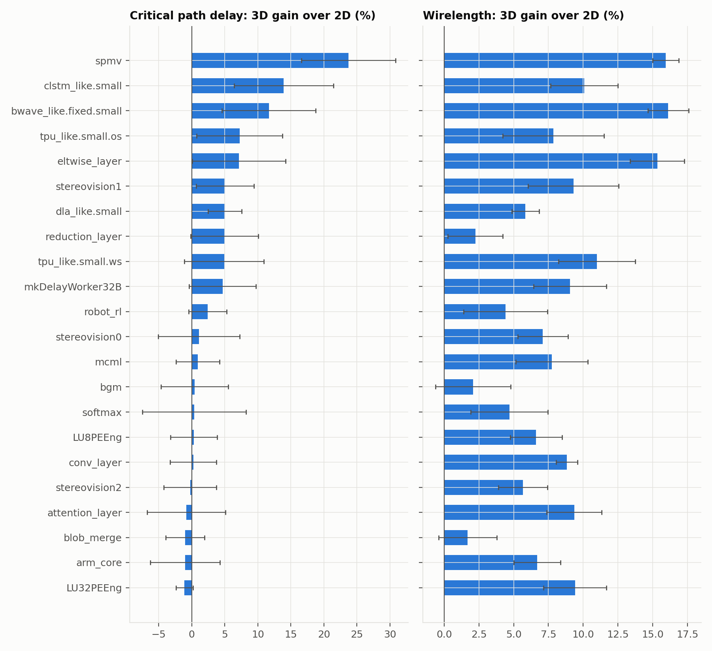
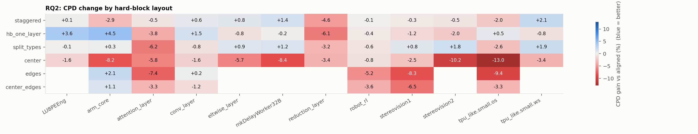
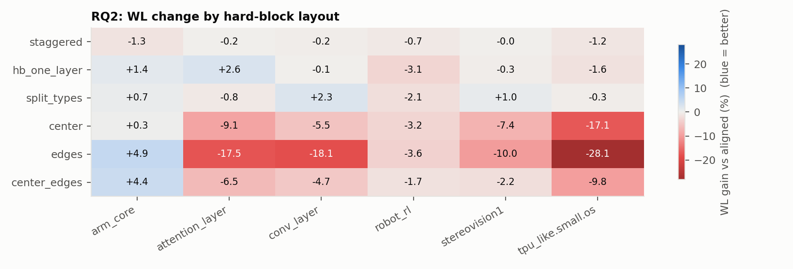
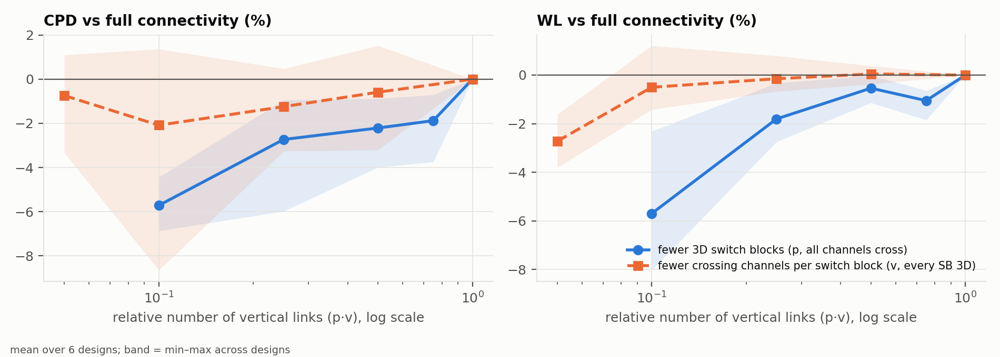

<!-- generated by campaign/analyze.py from campaign_work/study/results (147 results) -->

## RQ1: 3D vs 2D at equal resources

Improvement of the 3D device over the 2D device with the same tile and block counts (positive = 3D better). Mean ± 95% CI over paired seeds.

| design | 2D | 3D | use CLB/DSP/BRAM (2D) | CPD 2D (ns) | CPD 3D (ns) | CPD gain % | WL gain % | seeds |
|---|---|---|---|---|---|---|---|---|
| spmv | 119×122 | 2×87×86 | 7/4/77% | 9.47 | 7.12 | +24.5 ± 11.0 | +16.2 ± 1.7 | 5 |
| tpu_like.small.os | 78×74 | 2×62×50 | 70/80/53% | 7.57 | 6.75 | +10.7 ± 4.6 | +8.3 ± 2.6 | 5 |
| tpu_like.small.ws | 71×86 | 2×62×50 | 64/77/67% | 12.89 | 11.93 | +7.3 ± 5.6 | +11.2 ± 2.1 | 5 |
| dla_like.small | 131×134 | 2×91×98 | 80/21/27% | 11.80 | 11.12 | +5.7 ± 4.2 | +7.0 ± 1.0 | 5 |
| reduction_layer | 55×62 | 2×46×38 | 38/0/74% | 8.29 | 7.81 | +5.6 ± 6.0 | +1.6 ± 1.6 | 5 |
| eltwise_layer | 87×86 | 2×62×62 | 25/5/75% | 6.74 | 6.36 | +5.5 ± 4.2 | +15.7 ± 3.6 | 5 |
| stereovision1 | 62×50 | 2×46×38 | 67/79/0% | 6.26 | 5.93 | +5.1 ± 4.4 | +9.3 ± 3.3 | 5 |
| bwave_like.fixed.small | 142×146 | 2×95×110 | 8/22/79% | 11.43 | 10.94 | +4.2 ± 5.3 | +16.9 ± 1.4 | 5 |
| mkDelayWorker32B | 62×50 | 2×46×38 | 32/0/78% | 9.12 | 8.79 | +3.5 ± 4.1 | +9.8 ± 1.5 | 5 |
| robot_rl | 62×50 | 2×42×38 | 74/19/75% | 12.11 | 11.68 | +3.4 ± 5.3 | +2.9 ± 1.5 | 5 |
| stereovision0 | 50×50 | 2×34×38 | 79/0/0% | 4.29 | 4.24 | +1.1 ± 6.2 | +7.1 ± 1.8 | 5 |
| bgm | 76×74 | 2×58×50 | 79/7/8% | 20.92 | 20.81 | +0.4 ± 5.1 | +2.1 ± 2.7 | 5 |
| softmax | 51×62 | 2×43×38 | 80/9/3% | 7.65 | 7.61 | +0.4 ± 7.8 | +4.7 ± 2.8 | 5 |
| LU32PEEng | 116×134 | 2×92×86 | 79/7/46% | 92.13 | 92.12 | -0.0 ± 3.4 | +10.8 ± 2.2 | 5 |
| stereovision2 | 88×110 | 2×78×62 | 45/79/1% | 17.56 | 17.59 | -0.2 ± 4.0 | +5.7 ± 1.8 | 5 |
| attention_layer | 78×98 | 2×63×62 | 41/28/79% | 10.61 | 10.68 | -0.7 ± 6.1 | +9.6 ± 1.5 | 5 |
| blob_merge | 30×38 | 2×23×26 | 76/0/0% | 11.58 | 11.69 | -1.0 ± 2.9 | +1.7 ± 2.1 | 5 |
| arm_core | 55×50 | 2×39×38 | 57/0/71% | 22.10 | 22.31 | -1.0 ± 5.3 | +6.7 ± 1.7 | 5 |
| LU8PEEng | 75×62 | 2×49×50 | 80/6/44% | 89.57 | 91.18 | -1.8 ± 1.9 | +6.3 ± 3.1 | 5 |
| conv_layer | 87×74 | 2×55×62 | 49/21/80% | 8.56 | 8.73 | -2.1 ± 2.6 | +8.2 ± 2.8 | 5 |

**Geomean over 20 designs: CPD +3.8%, WL +8.2%.** 3D wins CPD on 13/20 and WL on 20/20 designs.

| property | Spearman vs CPD gain | Spearman vs WL gain |
|---|---|---|
| 2D device side (sqrt tiles) | +0.26 | +0.54 |
| hard-block share of used tiles | +0.37 | +0.68 |
| CLB utilization | -0.28 | -0.50 |
| max(DSP,BRAM) utilization | +0.20 | +0.48 |

## RQ2: hard-block placement across layers

Each layout vs the aligned reference (evenly spread hard-block columns, identical layers) on the same 3D device, same block totals. Positive = better than aligned. Mean ± 95% CI over paired seeds.

**CPD gain % vs aligned**

| layout | LU8PEEng | arm_core | attention_layer | conv_layer | eltwise_layer | mkDelayWorker32B | reduction_layer | robot_rl | stereovision1 | stereovision2 | tpu_like.small.os | tpu_like.small.ws | mean |
|---|---|---|---|---|---|---|---|---|---|---|---|---|---|
| staggered | +0.1 ± 2.1 | -2.9 ± 5.2 | -0.5 ± 5.4 | +0.6 ± 5.4 | +0.8 ± 4.5 | +1.4 ± 5.5 | -4.6 ± 15.9 | -0.1 ± 5.2 | -0.3 ± 6.0 | -0.5 ± 6.3 | -2.0 ± 1.9 | +2.1 ± 4.9 | -0.5 |
| hb_one_layer | +3.6 ± 2.8 | +4.5 ± 3.6 | -3.8 ± 4.0 | +1.5 ± 4.6 | -0.8 ± 3.2 | -0.2 ± 4.0 | -6.1 ± 7.9 | -0.4 ± 3.4 | -1.2 ± 2.8 | -2.0 ± 2.7 | +0.5 ± 0.5 | -0.8 ± 1.6 | -0.4 |
| split_types | -0.1 ± 3.3 | +0.3 ± 6.3 | -6.2 ± 7.7 | -0.8 ± 3.7 | +0.9 ± 4.7 | +1.2 ± 4.0 | -3.2 ± 10.5 | -0.6 ± 6.1 | +0.8 ± 4.4 | +1.8 ± 1.9 | -2.6 ± 6.3 | +1.9 ± 5.5 | -0.6 |
| center | -1.6 ± 4.5 | -8.2 ± 11.7 | -5.8 ± 6.8 | -1.6 ± 3.6 | -5.7 ± 6.6 | -8.4 ± 9.4 | -3.4 ± 9.2 | -0.8 ± 4.9 | -2.5 ± 2.9 | -10.2 ± 9.4 | -13.0 ± 7.7 | -3.4 ± 4.1 | -5.4 |
| edges | – | +2.1 ± 4.3 | -7.4 ± 9.2 | +0.2 ± 3.3 | – | – | – | -5.2 ± 4.5 | -8.3 ± 3.2 | – | -9.4 ± 2.1 | – | -4.7 |
| center_edges | – | +1.1 ± 1.9 | -3.3 ± 7.2 | -1.2 ± 6.2 | – | – | – | -3.6 ± 6.5 | -6.5 ± 4.6 | – | -3.3 ± 3.8 | – | -2.8 |

**WL gain % vs aligned**

| layout | LU8PEEng | arm_core | attention_layer | conv_layer | eltwise_layer | mkDelayWorker32B | reduction_layer | robot_rl | stereovision1 | stereovision2 | tpu_like.small.os | tpu_like.small.ws | mean |
|---|---|---|---|---|---|---|---|---|---|---|---|---|---|
| staggered | +0.4 ± 2.0 | -1.3 ± 1.7 | -0.2 ± 2.4 | -0.2 ± 3.2 | -1.1 ± 1.1 | +0.5 ± 0.6 | +1.0 ± 3.1 | -0.7 ± 0.8 | -0.0 ± 4.3 | +0.5 ± 2.1 | -1.2 ± 1.8 | +1.1 ± 1.9 | -0.1 |
| hb_one_layer | +2.1 ± 1.8 | +1.4 ± 0.6 | +2.6 ± 1.9 | -0.1 ± 2.4 | +1.6 ± 2.3 | +2.2 ± 2.3 | +0.7 ± 1.5 | -3.1 ± 1.2 | -0.3 ± 2.6 | -1.1 ± 2.3 | -1.6 ± 1.4 | +1.3 ± 3.0 | +0.5 |
| split_types | +0.2 ± 1.9 | +0.7 ± 0.7 | -0.8 ± 1.6 | +2.3 ± 1.2 | +3.0 ± 2.2 | +5.3 ± 1.9 | +2.4 ± 1.1 | -2.1 ± 2.2 | +1.0 ± 3.0 | +4.3 ± 2.0 | -0.3 ± 0.9 | +2.4 ± 2.6 | +1.5 |
| center | -0.1 ± 2.4 | +0.3 ± 4.5 | -9.1 ± 1.9 | -5.5 ± 3.9 | +4.5 ± 3.2 | +0.2 ± 2.5 | -0.3 ± 3.5 | -3.2 ± 2.5 | -7.4 ± 2.2 | -15.1 ± 1.5 | -17.1 ± 0.5 | -8.3 ± 2.0 | -5.1 |
| edges | – | +4.9 ± 2.7 | -17.5 ± 2.3 | -18.1 ± 1.9 | – | – | – | -3.6 ± 2.3 | -10.0 ± 6.3 | – | -28.1 ± 4.2 | – | -12.1 |
| center_edges | – | +4.4 ± 1.7 | -6.5 ± 1.2 | -4.7 ± 2.2 | – | – | – | -1.7 ± 1.5 | -2.2 ± 3.0 | – | -9.8 ± 1.6 | – | -3.4 |

## RQ3: vertical connectivity vs cost

3D reference layout with a fraction p of switch blocks made 3D (all channels crossing), and with all switch blocks 3D but only a fraction v of channels crossing. Change vs full connectivity (p = 1, v = 1); positive = better. The 2D device (no vertical links) is shown for scale.

| design | config | relative links | CPD vs full % | WL vs full % |
|---|---|---|---|---|
| attention_layer | p=0.1, v=1 | 0.10 | -8.9 ± 16.7 | -5.8 ± 2.6 |
| attention_layer | p=0.2, v=0.5 | 0.10 | -4.5 ± 11.2 | -2.3 ± 2.8 |
| attention_layer | p=0.25, v=1 | 0.25 | -1.7 ± 4.2 | -1.4 ± 2.9 |
| attention_layer | p=0.5, v=0.2 | 0.10 | -1.7 ± 8.7 | -0.8 ± 2.4 |
| attention_layer | p=0.5, v=0.5 | 0.25 | -1.5 ± 6.5 | -0.7 ± 1.8 |
| attention_layer | p=0.5, v=1 | 0.50 | -1.3 ± 5.6 | -1.5 ± 1.4 |
| attention_layer | p=0.75, v=1 | 0.75 | +0.1 ± 3.9 | -0.2 ± 1.4 |
| attention_layer | p=1, v=0.05 | 0.05 | +1.1 ± 5.0 | -0.7 ± 0.4 |
| attention_layer | p=1, v=0.1 | 0.10 | +0.6 ± 5.7 | +0.1 ± 2.2 |
| attention_layer | p=1, v=0.25 | 0.25 | -0.1 ± 2.7 | +0.1 ± 2.9 |
| attention_layer | p=1, v=0.5 | 0.50 | -1.9 ± 4.8 | +0.7 ± 2.4 |
| attention_layer | 2D device | 0 | +0.5 ± 6.0 | -10.6 ± 1.8 |
| conv_layer | p=0.1, v=1 | 0.10 | -4.7 ± 2.9 | -4.9 ± 2.0 |
| conv_layer | p=0.2, v=0.5 | 0.10 | -0.8 ± 2.1 | -3.2 ± 3.0 |
| conv_layer | p=0.25, v=1 | 0.25 | -0.9 ± 5.0 | -1.4 ± 2.4 |
| conv_layer | p=0.5, v=0.2 | 0.10 | -0.3 ± 6.5 | -2.3 ± 1.5 |
| conv_layer | p=0.5, v=1 | 0.50 | -0.6 ± 3.5 | -0.1 ± 1.4 |
| conv_layer | p=1, v=0.1 | 0.10 | +0.9 ± 3.3 | -1.0 ± 2.6 |
| conv_layer | p=1, v=0.25 | 0.25 | +1.1 ± 3.5 | +1.0 ± 1.0 |
| conv_layer | p=1, v=0.5 | 0.50 | +0.2 ± 2.9 | +0.6 ± 3.1 |
| conv_layer | 2D device | 0 | +2.0 ± 2.5 | -9.0 ± 3.3 |
| eltwise_layer | p=0.1, v=1 | 0.10 | -5.4 ± 4.2 | -9.0 ± 1.7 |
| eltwise_layer | p=0.2, v=0.5 | 0.10 | -2.5 ± 3.3 | -4.1 ± 1.9 |
| eltwise_layer | p=0.25, v=1 | 0.25 | -6.0 ± 9.4 | -3.1 ± 2.0 |
| eltwise_layer | p=0.5, v=0.2 | 0.10 | -6.1 ± 7.6 | -1.6 ± 1.1 |
| eltwise_layer | p=0.5, v=1 | 0.50 | +0.3 ± 5.1 | -1.3 ± 1.9 |
| eltwise_layer | p=1, v=0.1 | 0.10 | -4.5 ± 1.6 | -1.7 ± 2.0 |
| eltwise_layer | p=1, v=0.25 | 0.25 | -6.0 ± 10.9 | +0.7 ± 1.8 |
| eltwise_layer | p=1, v=0.5 | 0.50 | -2.7 ± 3.7 | +0.3 ± 1.6 |
| eltwise_layer | 2D device | 0 | -5.9 ± 4.5 | -18.7 ± 5.1 |
| robot_rl | p=0.1, v=1 | 0.10 | -3.4 ± 6.8 | -1.8 ± 0.1 |
| robot_rl | p=0.2, v=0.5 | 0.10 | +1.7 ± 4.8 | -1.9 ± 1.6 |
| robot_rl | p=0.25, v=1 | 0.25 | +1.8 ± 6.0 | -0.1 ± 0.7 |
| robot_rl | p=0.5, v=0.2 | 0.10 | +0.8 ± 5.6 | +0.3 ± 1.6 |
| robot_rl | p=0.5, v=0.5 | 0.25 | +2.5 ± 2.4 | -0.5 ± 1.6 |
| robot_rl | p=0.5, v=1 | 0.50 | -0.4 ± 4.8 | -0.2 ± 1.3 |
| robot_rl | p=0.75, v=1 | 0.75 | +1.6 ± 4.6 | -0.4 ± 0.7 |
| robot_rl | p=1, v=0.05 | 0.05 | +1.2 ± 5.2 | -0.8 ± 1.7 |
| robot_rl | p=1, v=0.1 | 0.10 | +1.2 ± 3.9 | -0.3 ± 0.4 |
| robot_rl | p=1, v=0.25 | 0.25 | +2.3 ± 4.1 | +0.3 ± 1.5 |
| robot_rl | p=1, v=0.5 | 0.50 | +3.4 ± 4.1 | +0.8 ± 0.8 |
| robot_rl | 2D device | 0 | -3.7 ± 5.8 | -3.0 ± 1.6 |
| stereovision1 | p=0.1, v=1 | 0.10 | -6.1 ± 2.7 | -7.8 ± 3.6 |
| stereovision1 | p=0.2, v=0.5 | 0.10 | -2.2 ± 3.8 | -4.1 ± 4.4 |
| stereovision1 | p=0.25, v=1 | 0.25 | -1.1 ± 2.7 | -2.7 ± 3.1 |
| stereovision1 | p=0.5, v=0.2 | 0.10 | +0.6 ± 3.5 | -2.5 ± 2.8 |
| stereovision1 | p=0.5, v=0.5 | 0.25 | -2.2 ± 4.7 | -3.1 ± 4.4 |
| stereovision1 | p=0.5, v=1 | 0.50 | -2.5 ± 1.5 | -0.4 ± 1.4 |
| stereovision1 | p=0.75, v=1 | 0.75 | -0.7 ± 4.1 | -1.8 ± 3.1 |
| stereovision1 | p=1, v=0.05 | 0.05 | -3.3 ± 4.6 | -3.8 ± 3.5 |
| stereovision1 | p=1, v=0.1 | 0.10 | +1.4 ± 1.6 | -0.3 ± 2.2 |
| stereovision1 | p=1, v=0.25 | 0.25 | +0.5 ± 2.4 | -0.7 ± 2.5 |
| stereovision1 | p=1, v=0.5 | 0.50 | +1.5 ± 4.2 | -0.3 ± 2.8 |
| stereovision1 | 2D device | 0 | -5.5 ± 4.8 | -10.3 ± 3.9 |
| tpu_like.small.os | p=0.1, v=1 | 0.10 | -3.6 ± 2.4 | -7.2 ± 1.6 |
| tpu_like.small.os | p=0.2, v=0.5 | 0.10 | -2.2 ± 4.8 | -4.2 ± 2.0 |
| tpu_like.small.os | p=0.25, v=1 | 0.25 | -3.1 ± 5.2 | -2.1 ± 1.9 |
| tpu_like.small.os | p=0.5, v=0.2 | 0.10 | -9.4 ± 7.5 | -2.2 ± 1.7 |
| tpu_like.small.os | p=0.5, v=0.5 | 0.25 | -1.6 ± 1.5 | -0.4 ± 1.1 |
| tpu_like.small.os | p=0.5, v=1 | 0.50 | -3.3 ± 6.5 | -1.4 ± 2.0 |
| tpu_like.small.os | p=0.75, v=1 | 0.75 | -2.0 ± 3.7 | -0.5 ± 1.1 |
| tpu_like.small.os | p=1, v=0.05 | 0.05 | -1.4 ± 6.9 | -3.3 ± 2.3 |
| tpu_like.small.os | p=1, v=0.1 | 0.10 | -2.7 ± 2.3 | -0.9 ± 3.3 |
| tpu_like.small.os | p=1, v=0.25 | 0.25 | -4.2 ± 4.1 | -0.2 ± 3.0 |
| tpu_like.small.os | p=1, v=0.5 | 0.50 | -1.4 ± 4.4 | -1.0 ± 1.9 |
| tpu_like.small.os | 2D device | 0 | -12.1 ± 5.7 | -9.1 ± 3.0 |

**Mean over designs, by strategy** (same link budget p·v):

| links | fewer 3D switch blocks: CPD / WL % | fewer crossing channels: CPD / WL % |
|---|---|---|
| 0.05 | – | -0.6 / -2.2 (n=4) |
| 0.1 | -5.4 / -6.1 (n=6) | -0.5 / -0.7 (n=6) |
| 0.25 | -1.8 / -1.8 (n=6) | -1.1 / +0.2 (n=6) |
| 0.5 | -1.3 / -0.8 (n=6) | -0.1 / +0.2 (n=6) |
| 0.75 | -0.3 / -0.7 (n=4) | – |

## RQ2 confirmation (10 paired seeds)

| design | layout | CPD gain % vs aligned | WL gain % vs aligned | seeds |
|---|---|---|---|---|
| conv_layer | hb_one_layer | -0.1 ± 2.5 | -0.7 ± 1.2 | 10 |
| conv_layer | hb_top | -0.8 ± 0.8 | -0.9 ± 1.3 | 10 |
| conv_layer | split_rev | +0.0 ± 2.4 | +2.1 ± 1.5 | 10 |
| conv_layer | split_types | +0.3 ± 1.9 | +1.9 ± 1.1 | 10 |
| eltwise_layer | hb_one_layer | -2.8 ± 2.5 | +1.6 ± 0.9 | 10 |
| eltwise_layer | hb_top | -1.3 ± 2.0 | +2.7 ± 0.7 | 10 |
| eltwise_layer | split_rev | -2.3 ± 3.4 | +2.5 ± 1.2 | 10 |
| eltwise_layer | split_types | -0.4 ± 2.9 | +3.5 ± 1.0 | 10 |
| mkDelayWorker32B | hb_one_layer | -1.7 ± 3.4 | +1.6 ± 1.1 | 10 |
| mkDelayWorker32B | hb_top | +0.8 ± 2.6 | +1.5 ± 1.1 | 10 |
| mkDelayWorker32B | split_rev | -0.9 ± 2.8 | +5.3 ± 0.8 | 10 |
| mkDelayWorker32B | split_types | +0.9 ± 3.5 | +4.3 ± 1.2 | 10 |
| reduction_layer | hb_one_layer | -5.9 ± 3.6 | +0.1 ± 1.4 | 10 |
| reduction_layer | hb_top | -2.2 ± 4.0 | -1.8 ± 0.9 | 10 |
| reduction_layer | split_rev | -1.3 ± 3.2 | +4.7 ± 1.0 | 10 |
| reduction_layer | split_types | -2.9 ± 4.5 | +2.8 ± 0.9 | 10 |
| stereovision2 | hb_one_layer | -2.6 ± 1.7 | -1.1 ± 1.3 | 10 |
| stereovision2 | hb_top | -2.9 ± 2.0 | -2.0 ± 1.2 | 10 |
| stereovision2 | split_rev | -1.4 ± 2.2 | +3.0 ± 1.8 | 10 |
| stereovision2 | split_types | +0.8 ± 2.5 | +4.4 ± 1.2 | 10 |
| tpu_like.small.ws | hb_one_layer | +0.0 ± 1.3 | +1.1 ± 1.2 | 10 |
| tpu_like.small.ws | hb_top | +1.7 ± 2.4 | +2.9 ± 1.0 | 10 |
| tpu_like.small.ws | split_rev | +0.3 ± 2.6 | +2.9 ± 1.1 | 10 |
| tpu_like.small.ws | split_types | +1.4 ± 2.4 | +1.8 ± 1.4 | 10 |

## RQ3: where to put the 3D switch blocks (fixed budget)

Change vs full connectivity. repeated_interval = evenly interleaved (the default).

| design | p | pattern | CPD vs full % | WL vs full % |
|---|---|---|---|---|
| attention_layer | 0.25 | repeated_interval | -1.7 ± 4.2 | -1.4 ± 2.9 |
| attention_layer | 0.25 | columns | -7.0 ± 5.9 | -3.9 ± 1.8 |
| attention_layer | 0.25 | core | -0.8 ± 5.3 | -2.9 ± 2.9 |
| attention_layer | 0.25 | perimeter | -8.1 ± 18.2 | -11.2 ± 2.5 |
| attention_layer | 0.25 | rows | -4.0 ± 4.6 | -3.8 ± 1.5 |
| conv_layer | 0.25 | repeated_interval | -0.9 ± 5.0 | -1.4 ± 2.4 |
| conv_layer | 0.25 | columns | -4.7 ± 5.2 | -3.0 ± 1.2 |
| conv_layer | 0.25 | core | -0.9 ± 3.6 | -2.6 ± 2.6 |
| conv_layer | 0.25 | perimeter | -7.0 ± 8.7 | -19.3 ± 4.8 |
| conv_layer | 0.25 | rows | -1.7 ± 3.5 | -4.1 ± 2.9 |
| eltwise_layer | 0.25 | repeated_interval | -6.0 ± 9.4 | -3.1 ± 2.0 |
| eltwise_layer | 0.25 | columns | -1.0 ± 7.0 | -3.8 ± 1.9 |
| eltwise_layer | 0.25 | core | +0.7 ± 2.1 | -2.4 ± 1.9 |
| eltwise_layer | 0.25 | perimeter | -40.3 ± 17.5 | -22.0 ± 3.4 |
| eltwise_layer | 0.25 | rows | -7.2 ± 7.3 | -4.5 ± 1.9 |
| robot_rl | 0.25 | repeated_interval | +1.8 ± 6.0 | -0.1 ± 0.7 |
| robot_rl | 0.25 | columns | +1.1 ± 4.5 | -2.0 ± 1.0 |
| robot_rl | 0.25 | core | +1.5 ± 5.8 | -0.8 ± 0.8 |
| robot_rl | 0.25 | perimeter | -4.7 ± 4.7 | -2.6 ± 1.6 |
| robot_rl | 0.25 | rows | -0.4 ± 6.8 | -1.0 ± 2.2 |
| stereovision1 | 0.25 | repeated_interval | -1.1 ± 2.7 | -2.7 ± 3.1 |
| stereovision1 | 0.25 | columns | -1.6 ± 2.4 | -4.6 ± 4.2 |
| stereovision1 | 0.25 | core | -0.4 ± 2.9 | -2.6 ± 3.2 |
| stereovision1 | 0.25 | perimeter | -13.0 ± 12.4 | -12.3 ± 4.1 |
| stereovision1 | 0.25 | rows | -4.0 ± 1.9 | -3.9 ± 1.0 |
| tpu_like.small.os | 0.25 | repeated_interval | -3.1 ± 5.2 | -2.1 ± 1.9 |
| tpu_like.small.os | 0.25 | columns | -5.0 ± 1.6 | -5.3 ± 1.0 |
| tpu_like.small.os | 0.25 | core | -9.1 ± 6.4 | -4.9 ± 1.9 |
| tpu_like.small.os | 0.25 | perimeter | -19.2 ± 5.7 | -12.6 ± 4.0 |
| tpu_like.small.os | 0.25 | rows | -3.6 ± 3.5 | -7.6 ± 0.8 |

## Failed runs

- rq1__mcml: RuntimeError: prepare mcml: synthesis failed: no run folder
